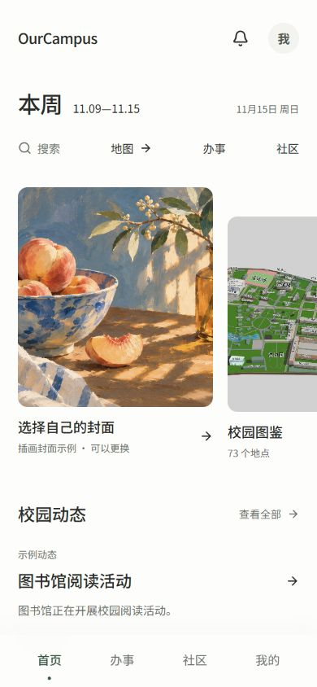
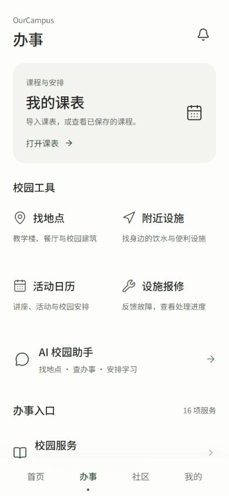
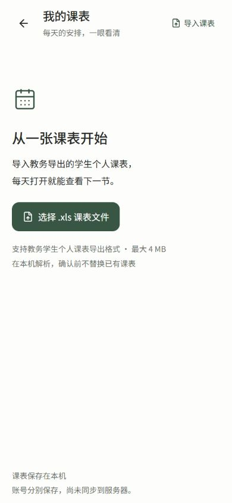
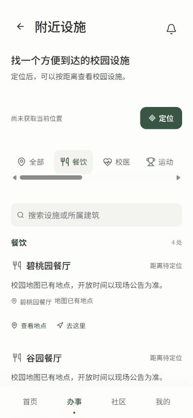
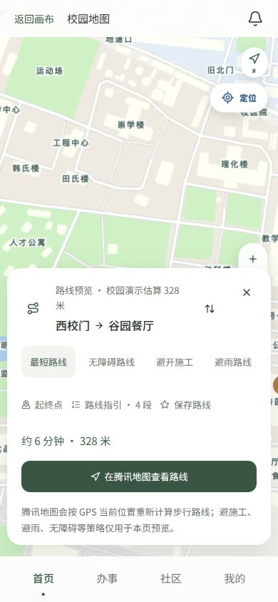
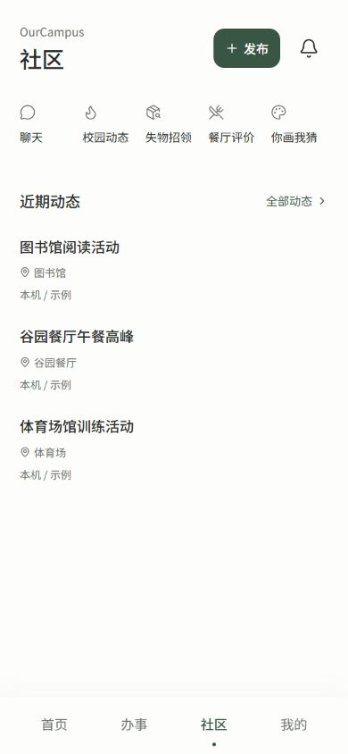
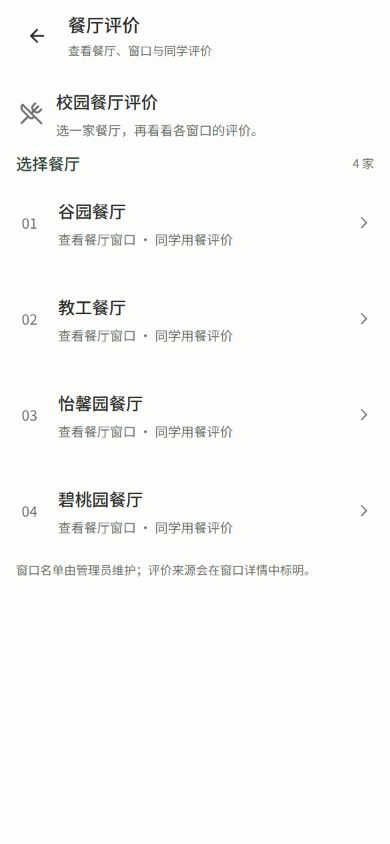
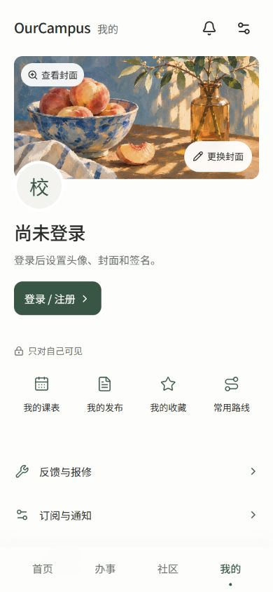

# OurCampus：学生日常走查

2026-11-15 · 当前 main `45c52f7` · 390×844 未登录本地预览

这是一轮重新设计前的实际走查，不是新版本验收。8 张图均为本轮浏览器捕获，另对照当前代码核对已登录能力。没有修改生产服务、发送消息、提交评价或读取私人账户资料。

## 学生每天打开它，最先需要什么

上课前知道下一节在哪里；吃饭前看看窗口和同学评价；找地方时少绕路；办完事知道结果到哪查；闲下来能看到同学的内容。现在已有不少功能，但入口组织要求用户先理解软件的栏目划分，再拼出完成任务的路径。

| 步骤 | 本轮观察 | 判断与改动优先级 |
| --- | --- | --- |
| 1 打开首页 | 首屏约三分之一展示默认静物封面；“本周”没有课程安排；个人封面与地图并列 | 高优先：把第一屏还给下一节课、最近地点和相关提醒，艺术展示移到个人页和真实内容中 |
| 2 找课表 | 需要进入“办事”后再打开课表 | 高优先：已导入时首页直接展示下一节；未导入时提供可跳过的轻量入口 |
| 3 打开课表 | 本轮设备无课表，显示 `.xls` 本机导入；从办事进入却标为“返回我的” | 返回文案和返回目的地都必须跟随来源。未验证已导入真实课表，教室不可继续找楼来自代码核对 |
| 4 找附近吃饭 | 餐饮筛选有效，但先消耗大量空间介绍定位和分类；结果只有“查看地点/去这里” | 高优先：餐厅承接窗口、菜单、评价和路线。未定位也应允许看餐厅内容，不强制定位或绕到社区 |
| 5 去谷园餐厅 | 尚未定位，直接得到“西校门→谷园餐厅”；标注校园演示估算 328 米、约 6 分钟 | 高优先：先确认起点。演示估算标注已有，但不能让学生把设备预设点误认成自己。腾讯服务本轮提示路线免费额度已用完，未验证真实路线成功 |
| 6 打开社区 | 首屏仍是五个功能入口和三个示例动态，真实内容区没有形成阅读吸引力 | 中高优先：社区应先看到内容，聊天和游戏有明确入口；示例不占据真实推荐流 |
| 7 查餐厅评价 | 从社区再次选择餐厅，然后才能进入窗口 | 高优先：与附近餐厅、地点详情共享餐厅和窗口标识，保留当前餐厅与筛选 |
| 8 打开我的 | 默认封面、未登录身份和四个私人工具；自定义封面只在本机 | 保留个性展示，但清楚区分“公开名片”和“只有我能看到的工具”。公开封面需另接服务能力，不能仅改文案称已同步 |

## 逐步截图

### 1 首页：主任务被封面挤到后面

### 2 办事：多个常用任务集中在二层

### 3 课表：可导入，但返回来源文案不准确

### 4 吃饭：餐厅和评价之间缺直接连接

### 5 路线：未确认的预设起点

### 6 社区：菜单和示例盖过真实内容

### 7 餐厅：另一套选择入口

### 8 我的：私人工具与个人装扮

## 代码核对揭示的其他断点

- `TimetableDayView` 已有下一节计算，但教室没有打开地点的出口；需要可靠建筑匹配和手选确认，不能猜出精确室内路线。
- 报修页同时展示本机模拟进度和云端通用上报入口。提交后的落点应进入该条记录；应用提交成功不等于学校已接单。
- 首页动态“查看全部”进入社区首页，未直接进入动态列表；“我的发布”打开云端列表也不定位原记录。
- 地区聊天与通知分离；通知只能跳地区，无法定位原消息；阅读地区和发送地区独立，容易发错地方。
- 他人主页当前仅有昵称、头像和最多 20 条大厅发言；自设封面、签名、标签并未公开。

## 已有能力值得保留

查地点不需要登录；餐厅有真实窗口与部分现场菜单；图片已有选择、压缩、预览和移除；地图与路线已有来源说明；课表能在本机解析后预览；弹层已有部分焦点恢复、滚动锁与减少动态效果适配。这些都应接进新的完整流程，而不是另外造一套展示数据。

## 无障碍与证据边界

窄屏分类存在横向溢出与细滚动条，部分可选模式不在首屏；页面的大段空白与小号说明降低了扫描效率。后续需实测 320px、大字体、键盘、读屏、错误提示和减少动态效果。截图不能证明全应用对比度或辅助技术合规。

本轮未登录，没有验证真实消息发送、相册上传、双账号照片读取、真实课表导入和学校受理链路。腾讯路线配额不足已记录，不能声称导航线上成功。
