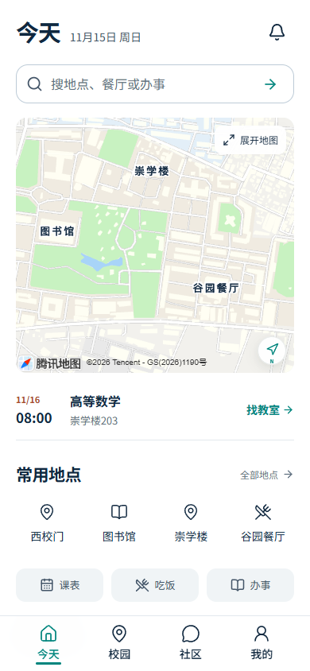
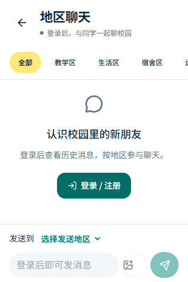
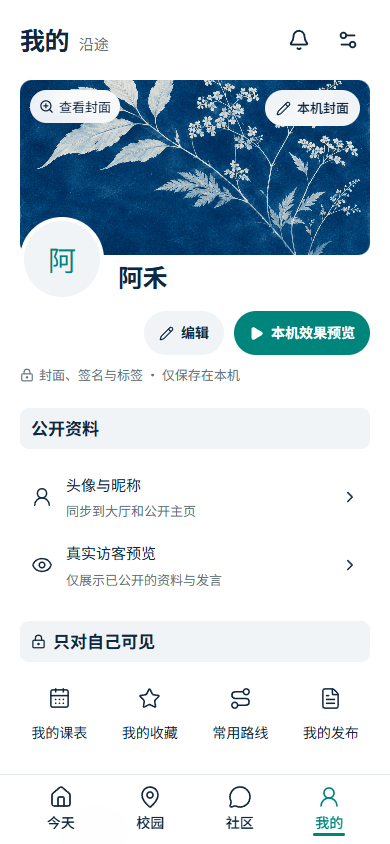

# 设计与页面预览

最新主分支采用 **1.20「沿途」** 方向，四个主入口为「今天、校园、社区、我的」。本目录保存设计过程与网页运行截图，Android 可安装体验包仍为 1.19；版本入口见[下载说明](../download.md)。

## 查看最新预览

- [1.20「沿途」交付与验证记录](../releases/2026-11-15-along-system-preview.md)：页面覆盖、任务返回、账号边界与待验收内容。
- [GitHub 网页与源码包](https://github.com/zhchunyu/Our-Campus/releases/tag/v1.20-along-preview)：网页包解压后通过静态 HTTP 服务访问，不直接双击 `index.html`。
- [设计走查与方向档案](2026-11-15-student-daily/index.html)：可下载后在浏览器打开的静态设计说明；GitHub 文件页展示源码。
- [选定稿与运行页面对照](2026-11-15-student-daily/final-runtime/comparison.png)。

## 代表页面

| 今天与课程 | 社区聊天 | 我的 |
| --- | --- | --- |
|  |  |  |

课程、聊天和账号画面中的数据用于本地测试，不代表云端真实用户记录。图片预览、组件运行、模拟账号与手机实测分别记录；这些截图不构成已发布 Android 新版的证明。

## 过程资料

| 资料 | 内容 |
| --- | --- |
| [学生日常走查](2026-11-15-student-daily/01-学生日常走查.md) | 从日常任务检查入口和页面链路 |
| [整款软件重构方案](2026-11-15-student-daily/02-整款软件重构方案.md) | 页面范围、任务衔接与信息组织 |
| [方向图与实施边界](2026-11-15-student-daily/03-方向图与实施边界.md) | 三套方向、选定结果与实现约束 |
| [最终运行截图](2026-11-15-student-daily/final-runtime/) | 实际网页与对照图，带 fixture 的文件使用本地测试数据 |
| [此前学生画布预览](../releases/2026-11-13-student-canvas-preview.md) | 11 月 13 日阶段性方案，后续由沿途方向继续推进 |

[返回文档中心](../README.md)
